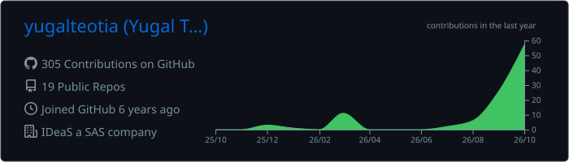
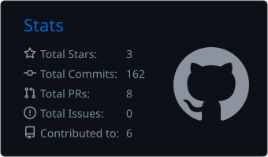
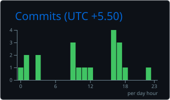
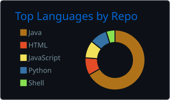
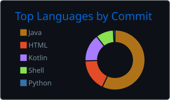

<h1 align="center">Hi, I'm Yugal Teotia 👋</h1>

  Full-stack software engineer building reliable APIs, microservices, and web applications.

<h3 align="center">
  Let's Connect
  
</h3>

  
  
  

  

## About me

- 🔭 Full-stack software engineer with **2+ years** of experience building SaaS features and cross-product APIs with **Java, Spring Boot, Ember.js, and MongoDB**
- 🧩 Experienced in **microservice upgrades, database optimization, and end-to-end delivery**
- 🌱 Currently exploring **Kubernetes, Kafka, and Redis**
- 💬 Ask me about **Java, REST/gRPC APIs, MongoDB, React, or Ember.js**

## Experience

- **Software Engineer** — IDeaS - A SAS Company, Pune, India *(Mar 2026 - Sep 2026)*
  Led the Spring Boot 2.6 to 3.5 migration across 20 Java modules, keeping a 353-test suite green.
- **Sr. Associate Software Developer** — IDeaS - A SAS Company, Pune, India *(Oct 2024 - Mar 2026)*
  Built REST and gRPC APIs for cross-product data exchange across 5 products; tuned MongoDB access, cutting repeated database calls.
- **Application Developer** — Data Nova India Pvt. Ltd., Noida, India *(Feb 2023 - May 2023)*
  Built ERP mobile app modules with MVVM; improved API-backed data retrieval by ~30%.

## Projects

### 🛒 ORCHARD — The Living Market

Grocery storefront built as the frontend for the Store REST API: catalog, product detail, cart, auth, and checkout running against the real backend, no mock data.

- **React, TypeScript, Vite, Tailwind CSS** — Stripe checkout, optimistic cart updates, in-memory token handling with silent refresh
- [Live Site](https://orchard.hostless.site) · [Repository](https://github.com/yugalteotia/Store-UI)

### Store REST API

Cart-management REST APIs with layered architecture and DTO mapping: request validation, consistent error handling, Flyway migrations, and OpenAPI documentation, deployed with JWT authentication and Stripe checkout.

- **Spring Boot, Spring Data JPA, MySQL, Flyway, JWT, Stripe, OpenAPI**
- [Live API](https://store-rest-api.hostless.app/swagger-ui/index.html) · [Repository](https://github.com/yugalteotia/spring_api_starter)

### 🎵 UNITY — Peer-to-Peer Music Sync

Local-network Android music session with leader/follower control, device discovery, pairing-code joining, and synchronized queues.

- **Kotlin, Jetpack Compose, Coroutines, Media3/ExoPlayer** — TCP commands, UDP playback synchronization
- [Repository](https://github.com/yugalteotia/unity-music-sync)

### CropConnect — Farmer-Merchant Marketplace

Digital marketplace connecting farmers directly with merchants: farmer registration and crop listing, merchant registration and crop search, with a real-time bargaining system.

- **Java, Spring Boot, Web**
- [Repository](https://github.com/yugalteotia/CropConnect)

## Education

- **PG Diploma in Advanced Computing (PG-DAC)** — Centre for Development of Advanced Computing (C-DAC), Pune *(Mar 2024 - Aug 2024)*
- **B.Tech, Computer Science & Engineering** — Dr. A.P.J. Abdul Kalam Technical University *(2020 - 2023)*

## Tech stack

  

## GitHub metrics

  

  
  

## Language usage

  
  

  Language cards summarize repository and commit usage; they do not represent proficiency.

## Contribution streak

  

  

